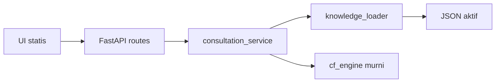

# Gambaran arsitektur

Browser statis (HTML/CSS/JavaScript) memanggil API FastAPI. Route memvalidasi masukan dengan Pydantic dan menyerahkannya ke layanan konsultasi. Layanan memuat satu dataset JSON melalui loader, memilih aturan yang cocok, lalu memanggil mesin CF murni. Hasil dan trace dikembalikan tanpa menyimpan riwayat.

Dependensi berjalan dari UI/API ke layanan, lalu ke loader dan mesin CF. `cf_engine` tidak mengimpor FastAPI, membaca file, atau mengetahui label hama. Skema Pydantic membatasi data di batas API dan loader. Konfigurasi memilih **satu** mode/dataset secara eksplisit; kegagalan dataset terverifikasi tidak memicu fallback demo. Sumber dan versi pengetahuan dibawa sampai respons. Rincian ada di [struktur](PROJECT_STRUCTURE.md) dan [kontrak API](API_CONTRACT.md).
